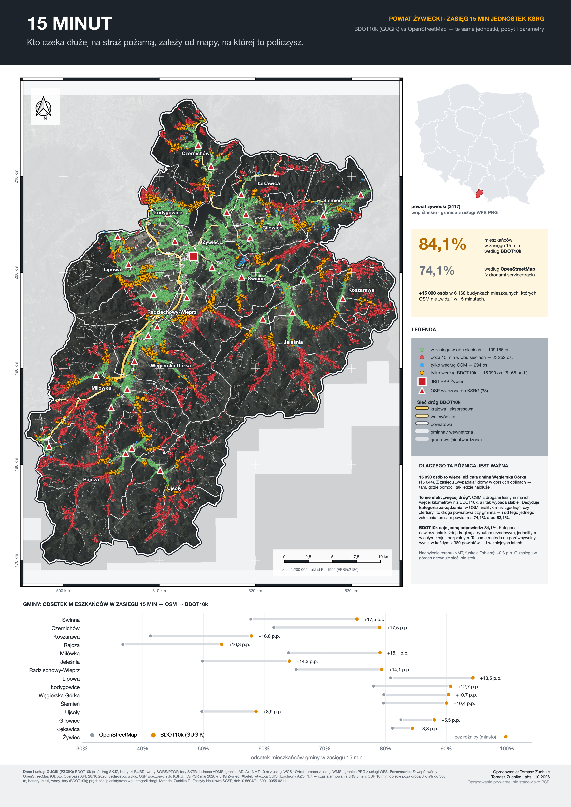

# 15 minut — powiat żywiecki

**Kto czeka dłużej na straż pożarną, zależy od mapy, na której to policzysz.**

Odsetek mieszkańców powiatu żywieckiego, do których jednostki Krajowego Systemu Ratowniczo-Gaśniczego
(JRG Żywiec i 33 OSP włączone do KSRG) mogą dotrzeć w 15 minut od zgłoszenia — policzony dwa razy,
z tymi samymi jednostkami, mieszkańcami i parametrami: na sieci dróg **BDOT10k** (GUGiK) i na sieci
**OpenStreetMap**.



## Wynik

| sieć dróg | ≤ 8 min | ≤ 15 min |
|---|---|---|
| OpenStreetMap (filtr dróg jak w artykule) | 12,6% | 71,8% |
| OpenStreetMap + drogi `service`/`track` | 13,3% | 74,1% |
| OpenStreetMap + `service`/`track`, `tertiary` = 50 km/h (test czułości) | 17,6% | 82,1% |
| BDOT10k — drogi publiczne | 14,1% | 76,6% |
| **BDOT10k — wszystkie drogi** | **15,2%** | **84,1%** |
| BDOT10k + dojście zależne od nachylenia (NMT 10 m, funkcja Toblera) | 14,9% | 83,3% |

Ludność powiatu w modelu: 147 802 osoby w 52 278 budynkach mieszkalnych.

## Dlaczego ta różnica jest ważna

- **15 090 osób** (6 168 budynków) jest w zasięgu 15 minut według BDOT10k, a poza nim według OSM —
  więcej, niż liczy cała gmina Węgierska Górka. To domy w górskich dolinach, gdzie pomoc i tak jedzie najdłużej.
- **To nie efekt „więcej dróg”.** OSM z drogami leśnymi i dojazdowymi ma w powiecie więcej kilometrów dróg
  niż BDOT10k, a mimo to wypada słabiej.
- **Decyduje kategoria zarządzania drogi.** W OSM analityk musi zgadnąć, czy `tertiary` to droga powiatowa
  czy gminna; od tego jednego założenia ten sam powiat ma 74,1% albo 82,1%, a przy wyższej prędkości OSM
  zawyża zasięg 8-minutowy. BDOT10k niesie kategorię i nawierzchnię każdej drogi jako atrybut urzędowy,
  jednolity w całym kraju — i daje jedną odpowiedź: 84,1%. Ta sama metoda da porównywalny wynik
  w każdym z 380 powiatów i w kolejnych latach.
- **Teren:** dojście piesze zależne od nachylenia zmienia wynik o −0,8 p.p. W górach o zasięgu decyduje sieć, nie stok.

## Metoda

Wtyczka QGIS **[Izochrony AZO](https://plugins.qgis.org/plugins/azo_izochrony/)** (to repozytorium, katalog `qgis_plugin/`),
algorytm „Wskaźnik pokrycia ludności”: graf drogowy + Dijkstra z superźródła, czas alarmowania JRG 3 min,
OSP 10 min, dojście poza drogą 3 km/h do 300 m, bariery (rzeki, wody, tory z BDOT10k), prędkości planistyczne
wg kategorii drogi (krajowa 60, wojewódzka 60, powiatowa 50, gminna 30, gruntowa 15 km/h).
Wersja 1.7 dodaje opcjonalny NMT (funkcja Toblera).
Podstawa metodyczna: Zuchlke T., Zeszyty Naukowe SGSP, doi:[10.5604/01.3001.0055.9211](https://doi.org/10.5604/01.3001.0055.9211).

## Jak odtworzyć

Wymaga QGIS 4.2 (GDAL i PyQGIS z pakietu QGIS) i zainstalowanej wtyczki Izochrony AZO 1.7.

```sh
./00_pobierz_dane.sh                        # BDOT10k, NMT (WCS), ortofotomapa (WMS), OSM (Overpass)
./01_przygotuj_dane.sh                      # sieci V1/V2/V3, bariery, obrysy → dane/wejscie.gpkg
narzedzia/pyqgis.sh 01b_popyt_i_jednostki.py  # mieszkańcy w budynkach + jednostki KSRG
./02_licz_warianty.sh v3 jednostki_ksrg     # warianty: v1 v1p v1pt v2 v3 v4
narzedzia/pyqgis.sh mapy/wykres_gmin.py && narzedzia/pyqgis.sh mapy/mapa_a3.py
```

OSM to migawka z 28.10.2026 — ponowne pobranie da nieco inne liczby dla wariantów OSM.

## Dane i licencje

- **Dane i usługi GUGiK (PZGiK):** BDOT10k (sieć dróg OT_SKJZ_L, budynki OT_BUBD_A, cieki OT_SWRS_L,
  wody OT_PTWP_A, tory OT_SKTR_L, miejscowości z liczbą mieszkańców OT_ADMS_P, granice OT_ADJA_A),
  NMT z usługi WCS, ortofotomapa z usługi WMS, granice PRG z usługi WFS — udostępniane bezpłatnie.
- **OpenStreetMap:** © współtwórcy OpenStreetMap, licencja ODbL (wyłącznie do porównania).
- **Jednostki:** wykaz OSP włączonych do KSRG (KG PSP, maj 2026) + JRG Żywiec, przypisane do budynków
  straży z BDOT10k — `dane/jednostki_ksrg.csv`.
- Kod: licencja MIT (jak wtyczka).

## Zastrzeżenie

Opracowanie prywatne. Nie jest stanowiskiem Państwowej Straży Pożarnej. Wykorzystano wyłącznie dane
publicznie dostępne. Prędkości są planistyczne, nie operacyjne — wynik opisuje porównanie sieci, a nie
rzeczywiste czasy dojazdu konkretnych zastępów.

Tomasz Zuchlke · październik 2026
